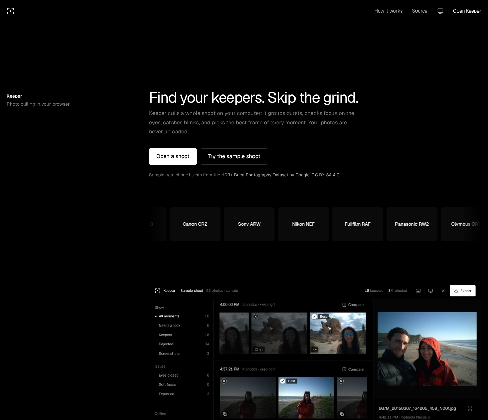
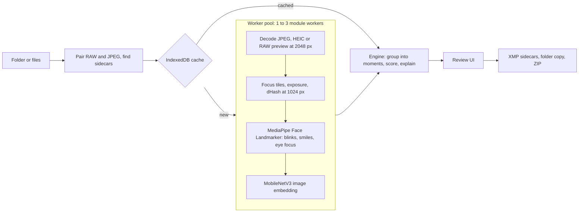

# Keeper

**Cull a whole photo shoot in your browser.** Keeper groups bursts into moments, checks focus on the eyes, catches blinks and blown highlights, and picks the best frame of every moment. Every decision comes with a reason, and your photos never leave your computer.

**Live:** [keeper-cull.netlify.app](https://keeper-cull.netlify.app)



## Why

I take photos, and after a shoot I come home with hundreds of near-identical frames. Finding the keepers means clicking through them one by one for hours, and the culling often takes longer than the shoot. Photographers I talked to described the same backlog. Keeper does the first pass so you only judge the close calls.

## What it does

- **Reads what cameras write.** JPEG, HEIC, PNG and WebP, plus RAW from Canon (CR2, CR3), Sony (ARW), Nikon (NEF), Fujifilm (RAF), Panasonic (RW2), Olympus (ORF) and DNG. RAW files are read through the full-size JPEG preview the camera embeds, found by a dependency-free TIFF and ISO BMFF parser. RAW+JPEG pairs count as one photo.
- **Groups bursts into moments** using capture time, a MobileNetV3 image embedding and a 64-bit difference hash.
- **Scores every frame** on eye focus, blinks, exposure, expression and how many faces are visible, then ranks frames inside each moment.
- **Explains itself.** "Best of 6 similar shots", "2 of 5 people have eyes closed", "Softer focus (41% as sharp as the best)".
- **Keyboard-first review.** Arrows to move, P to keep, X to reject, C to compare a moment side by side with zoomed face crops.
- **Exports to your workflow.** Star ratings and labels in `.xmp` sidecars for Lightroom and Capture One (merged into existing sidecars, never overwriting edits), a copy of the keepers in any folder, or a streamed ZIP.
- **Remembers.** Analysis is cached per file in IndexedDB, so reopening a shoot is instant, and your decisions survive reloads.
- **Private by design.** All analysis runs on your machine in WebAssembly. No uploads, no account, and a strict Content Security Policy.
- **Works offline and installs like an app.** A service worker generated at build time precaches the app shell and caches the versioned models, so after one visit Keeper culls with no connection.

## How it works



1. **Ingest** (`src/lib/ingest`): files come from a folder picker, a drag and drop, or a file input. Files with the same name in the same folder are paired, and existing `.xmp` sidecars are attached.
2. **Decode** (`src/lib/formats`, `src/lib/image`): JPEGs decode natively with EXIF rotation. RAW files are parsed for embedded previews: TIFF IFD chains and SubIFDs (CR2, NEF, ARW, DNG), CR3's `PRVW` box, RAF's fixed header, and a marker scan as a fallback. Lossless raw data that also looks like JPEG is rejected by its SOF marker. HEIC uses the browser decoder where it exists and a lazily loaded libheif build elsewhere.
3. **Measure** (`src/lib/analysis`): variance of the Laplacian per 128 px tile (the 90th percentile tile tracks the subject even with a blurred background), luminance histogram and clipping, a difference hash, then MediaPipe's Face Landmarker. Its blendshape scores (`eyeBlinkLeft`, `eyeBlinkRight`, `mouthSmile*`) detect blinks and smiles, and the eye regions from its 478 landmarks are cropped at full resolution to measure eye focus. Small faces get a second pass over four overlapping tiles.
4. **Decide** (`src/lib/engine`): pure functions, unit tested, rerun instantly when settings change.
5. **Review and export** (`src/pages/cull`, `src/lib/export`).

## The culling model

**Moments.** Photos are sorted by capture time. Neighbours join the same moment when they are a burst (within 2 s and embedding similarity of at least 0.72) or a repeat (within 90 s with similarity of at least 0.89, or at least 0.80 when the layout hashes also agree). A drift check against the first frame stops slow pans from chaining forever. The Tight and Loose settings change these thresholds.

**Score inside a moment.**

```
score = 0.50 focus + 0.25 eyes + 0.10 exposure + 0.08 face coverage + 0.07 smile
```

| Signal | Measured as |
| --- | --- |
| Focus | Eye-region sharpness relative to the sharpest frame in the moment (70%), plus whole-frame subject sharpness (30%). Square-rooted so a slightly soft frame is not punished like a missed one. |
| Eyes | Share of subject faces with open eyes. Both eyes at a blink score of 0.55 or more count as closed. Smiling pushes blink scores to about 0.3, which stays open. |
| Exposure | Penalties for clipped highlights and for frames that are dark with no bright tones. |
| Face coverage | Faces in this frame compared with the most in the moment, so a frame where someone turned away loses. |
| Smile | Average smile score, a light tie-breaker. |

Background faces smaller than 15% of the largest face are ignored. The best frame is kept; extra picks per moment are kept only if they score within 80% of the best. Single frames are rejected only for severe problems, and frames that are close calls or the best of a weak set are marked **Needs a look**.

**Screenshots and graphics** are set aside before any of this. A file counts as one when its name says screenshot, when it carries the "Screenshot" tag iPhones and Macs write, or when it has no camera information and its pixels look drawn: most neighbouring pixels exactly equal (sensors add noise, screens do not) and the 16 most common colors covering most of the frame. Judged as photos, white app backgrounds would read as blown highlights, and crisp text would raise the shoot's focus baseline until real photos looked soft. Camera files are never treated as graphics, so a lens-cap frame is still rejected as a bad photo.

**Known limits.** The face detector is tuned for faces that fill part of the frame, so crowd shots with tiny faces may be judged on whole-frame focus. RAW analysis uses the camera's embedded preview, which reflects the camera's own rendering. The thresholds are a starting point; the eval script below is how to check them against a real photographer's choices.

## Measuring accuracy

`scripts/eval.mjs` runs the real pipeline in headless Chromium on a shoot you have already culled, and compares Keeper's picks with yours:

```bash
npx playwright install chromium
npm run eval -- --shoot ~/Pictures/smith-wedding --picks ~/Pictures/smith-wedding/selects
npm run eval -- --shoot ~/Pictures/smith-wedding --xmp-min-rating 1
```

It reports precision, recall, F1, reject agreement and the **moment hit rate**: in how many moments that contain one of your picks Keeper also kept one of them. Results go to `eval-output/report.md`, which is not committed.

## Performance notes

- Workers are sized by CPU cores and device memory (1 to 3), since each holds its own copy of the models.
- Images decode straight to 2048 px; whole-frame metrics run at 1024 px.
- Tiled face passes only run when the full frame has no subject face.
- Results reach the UI in batches, and the moment list and grids are virtualized, so a 2,000 photo shoot scrolls smoothly.
- ZIP exports stream to disk in Chrome and Edge, and split into parts elsewhere.

## Quality checks

- **Lighthouse** (mobile, production build): 100 Performance, 100 Accessibility, 100 Best Practices, 100 SEO. LCP 1.0 s, CLS 0.
- **axe-core**: no accessibility violations on the landing page, open screen, review screen, compare view or export dialog, in light and dark themes.
- **Unit tests** cover the TIFF, JPEG, CR3 and HEIF parsers (with synthetic files built byte by byte), the focus, exposure and hash metrics, and the grouping and scoring engine. CI runs lint, tests and a production build on every push.
- **Real camera files**: the parsers read camera, lens settings and capture time from real Canon CR2 and CR3, Nikon NEF, DNG, Fujifilm RAF and Panasonic RW2 files (ExifTool's test set). Point `KEEPER_REAL_RAW` at a folder of RAW files to run that check: `KEEPER_REAL_RAW=~/raw-samples npm test`.
- **Scale**: a 400 photo shoot analyzes at about 11 photos a second in headless Chromium on a modest cloud CPU, and stays responsive while reviewing.

## Running locally

```bash
npm install
npm run dev      # http://localhost:5173
npm test         # unit tests (parsers, metrics, engine)
npm run lint
npm run build    # type check and production build
```

Requires Node 20 or newer. The MediaPipe runtime is copied from `node_modules` at build time; the two model files live in `public/models`.

## Project structure

```
src/
  lib/
    formats/   TIFF, JPEG, ISO BMFF readers, RAW preview extraction, EXIF
    image/     decoding and orientation (worker side)
    analysis/  focus, exposure, dHash, MediaPipe faces and embeddings
    worker/    analyzer worker and the pool that schedules it
    engine/    grouping, scoring, reasons (pure, unit tested)
    ingest/    folder, drag and drop and file input handling, RAW+JPEG pairing
    store/     session state (Zustand), IndexedDB cache, preferences
    export/    XMP sidecars, folder copy, ZIP
  pages/
    landing/   marketing page
    cull/      the culling app
scripts/       eval and build helpers
dev/           headless harness used by the eval script
```

## Built with

React 19, TypeScript, Vite, Zustand, TanStack Virtual, MediaPipe Tasks Vision, idb, client-zip, libheif-js, Vitest, Playwright and Netlify.

## Credits and licenses

- Keeper is MIT licensed.
- Sample shoot: frames from the [HDR+ Burst Photography Dataset](https://hdrplusdata.org) by Google (Hasinoff et al., SIGGRAPH Asia 2016), developed from the raw bursts and resized, shared under [CC BY-SA 4.0](https://creativecommons.org/licenses/by-sa/4.0/). The three screenshots in the set were made for Keeper. See `public/samples/LICENSE.txt`.
- Face Landmarker and MobileNetV3 image embedder models and the MediaPipe runtime: Apache 2.0, Google.
- libheif-js: LGPL 3.0, loaded on demand as a separate file only for HEIC in browsers without native support.
- Inter typeface: SIL Open Font License 1.1.
